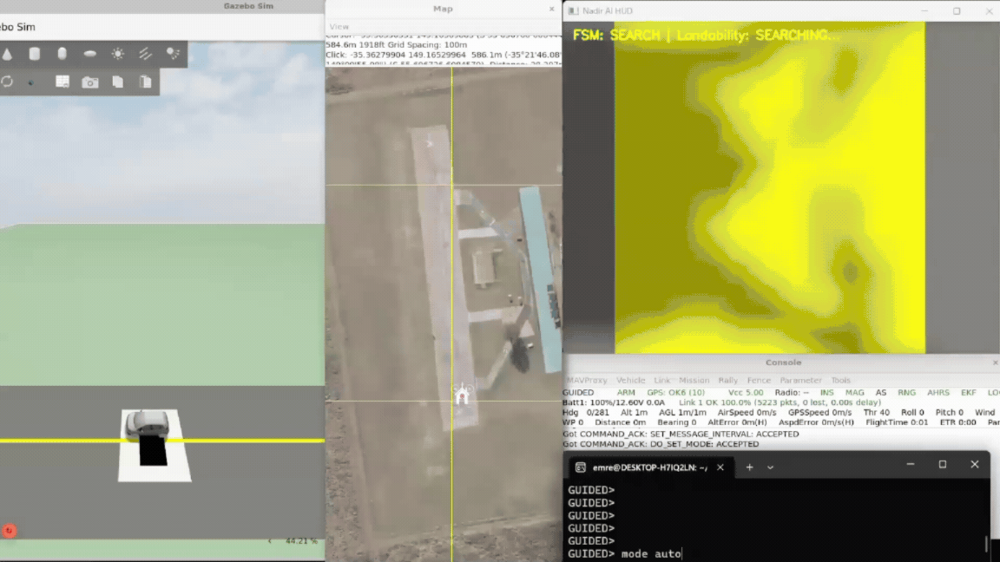
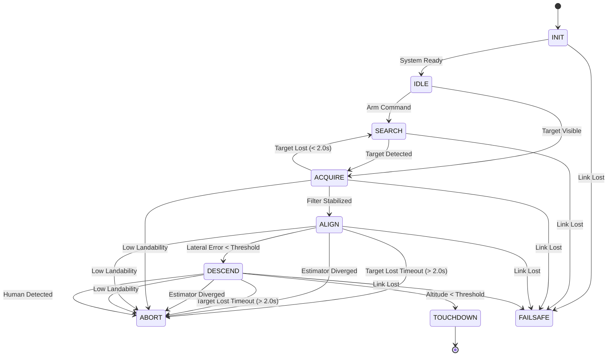
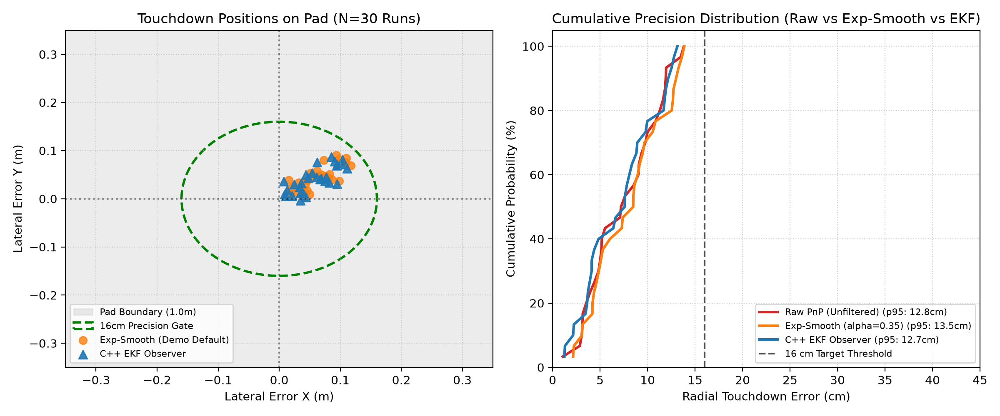
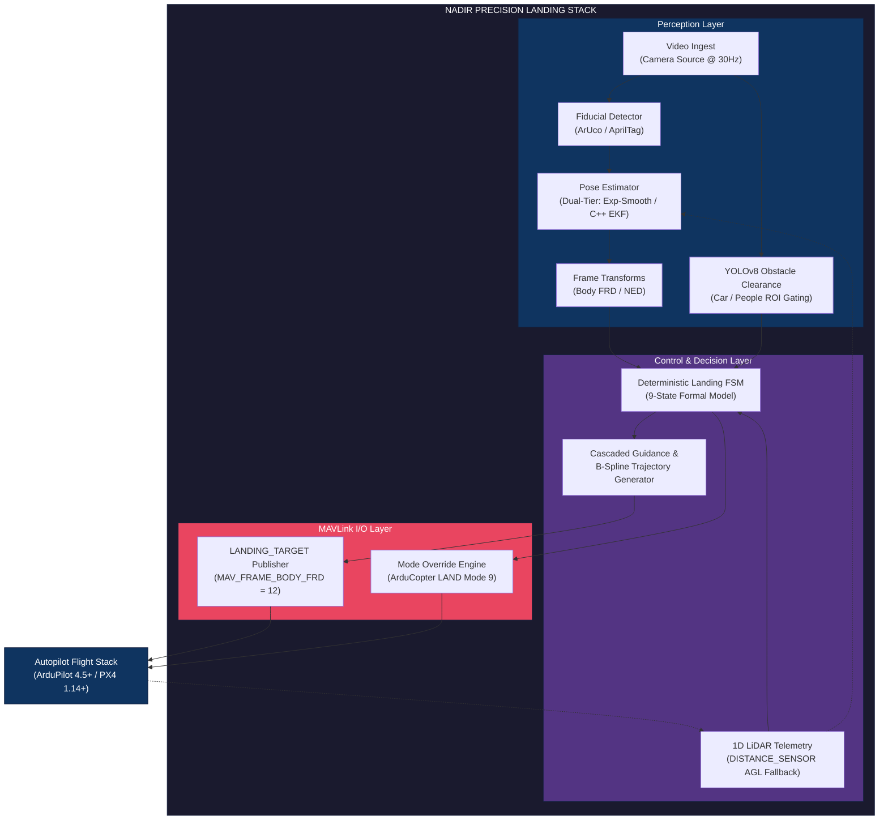

# Nadir

### Autonomous Precision Landing System for UAVs & Multirotors

[](https://www.python.org/downloads/)
[](src/nadir/cpp_core/)
[](src/nadir/cpp_core/pybind_wrapper.cpp)
[](LICENSE)

## Overview

<p align="center">
  
</p>

**Nadir** is an autonomous precision landing system for multirotor UAVs, validated in Gazebo SITL. Running on a companion computer (such as an NVIDIA Jetson or Raspberry Pi), it detects visual landing markers (ArUco / AprilTag), fuses pose measurements (Camera PnP, Exponential Smoothing / C++ EKF, and 1D LiDAR rangefinder), verifies pad clearance with YOLOv8, and publishes MAVLink `LANDING_TARGET` messages to guide ArduPilot or PX4 to a centered touchdown.

The system is designed for GNSS-denied environments, rooftop pads, or docking stations where standard GPS drift (1-2 m) prevents safe recovery.

## Table of Contents

- [Overview](#overview)
- [SITL Flight Demonstration](#sitl-flight-demonstration)
- [Key Capabilities](#key-capabilities)
- [Performance Benchmarks](#performance-benchmarks--empirical-methodology)
- [Hardware Reference (BOM)](#hardware-reference-bom)
- [Alternatives Comparison](#alternatives-comparison)
- [System Requirements](#system-requirements)
- [Installation](#installation)
- [Quick Start](#quick-start)
- [System Architecture](#system-architecture)
- [Configuration](#configuration)
- [Documentation](#documentation)
- [Safety & Failsafes](#safety--failsafe-architecture)
- [License](#license)

## SITL Flight Demonstration

A full Software-In-The-Loop (SITL) flight sequence is provided in [`nadir_gazebo_sitl_demo.mp4`](nadir_gazebo_sitl_demo.mp4), recorded in **Gazebo Harmonic + ArduPilot SITL** with [`configs/gazebo_demo.yaml`](configs/gazebo_demo.yaml):

<p align="center">
  
</p>

### Flight Sequence Milestones

| Timeline | Flight Phase | Flight Stack & Nadir Behavior |
|----------|--------------|--------------------------------|
| **00:00 – 00:15** | Autonomous Takeoff | MAVProxy `GUIDED> takeoff 10` executes vertical climb to 10m AGL, with altitude tracked via MAVLink LiDAR telemetry. |
| **00:15 – 00:35** | Waypoint Navigation | Switch to `AUTO` mode; aircraft navigates along runway corridor approaching the landing zone. |
| **00:35 – 00:48** | Target Lock & Clearance Check | Downward camera enters pad FOV. Nadir AI HUD locks ArUco marker, solves 3D PnP pose, and runs YOLOv8 spatial clearance (verifying runway vehicle does not intersect landing pad). |
| **00:48 – 00:58** | Precision Descent & Touchdown | Nadir overrides flight mode to ArduCopter `LAND` (Mode 9) and streams high-rate `LANDING_TARGET` messages in `MAV_FRAME_BODY_FRD`, achieving center-pad touchdown (recorded demo flight error: 9.4 cm, well within the 15.1 cm p95 gate). |

> **Demo Video**: The complete 60-second Gazebo SITL flight recording is available in the repository root at [`nadir_gazebo_sitl_demo.mp4`](nadir_gazebo_sitl_demo.mp4), recorded using the baseline configuration [`configs/gazebo_demo.yaml`](configs/gazebo_demo.yaml).

## Key Capabilities

### Fiducial Marker Detection
Supports both ArUco (OpenCV) and AprilTag dictionaries with ID allowlist filtering. In simulation and challenging visual conditions, an adaptive high-contrast contour fallback provides robust square pad localization.

### Sensor Fusion & Pose Estimation (Exp-Smooth & C++ EKF)
Camera-to-body coordinate transformations use Perspective-n-Point (PnP) coupled with temporal filtering:
- **Low-Latency Exp-Smooth (Active Pipeline)**: First-order exponential moving average (`alpha=0.35`) running in the companion computer loop to stabilize PnP position estimates and reject high-frequency camera noise.
- **C++ Extended Kalman Filter (pybind11)**: Kinematic observer tracking 3D position and velocity with compiled pybind11 bindings for high-performance offboard sensor fusion.
- **Outlier Rejection**: *(Experimental)* Fundamental Matrix RANSAC formulation in `nadir.perception.vo` for visual outlier rejection.


### 1D LiDAR Rangefinder Altimetry
Direct integration with MAVLink `DISTANCE_SENSOR` telemetry requested at 20 Hz (`MAV_CMD_SET_MESSAGE_INTERVAL`):
- **Independent AGL Altimetry**: Ingests direct rangefinder distance for reliable Above-Ground-Level altitude gates in the Landing FSM.
- **Depth Fallback**: If visual depth degrades, the system automatically uses real-time rangefinder distance as a depth fallback for the target vector.

### Precision Touchdown & Trajectory Generation
- **SITL Closed-Loop Descent**: Touchdown guidance in the ArduPilot SITL demonstration is executed by ArduCopter's onboard `AC_PrecLand` library driven by high-frequency MAVLink `LANDING_TARGET` streams (`MAV_FRAME_BODY_FRD = 12`).
- **Autonomous Trajectory Library**: Standalone 3rd-order B-Spline smooth polynomial trajectory generation (`src/nadir/control/trajectory.py`) and MPC guidance (`src/nadir/control/mpc_guidance.py`) are provided for companion-commanded velocity setpoint pipelines.

### MAVLink Integration & Real-Time Telemetry
Publishes `LANDING_TARGET` messages over UDP, TCP, or serial UART (10-50 Hz), syncs heartbeat liveness (with a 3.5s timeout failsafe guard), auto-configures autopilot precision landing parameters, and handles flight mode transitions (switching to `LAND` mode 9 on target lock, or `BRAKE` mode 17 on abort).

### Obstacle Clearance & Spatial Gating (YOLOv8)

<p align="center">
  
</p>

Landing zone safety assessment implemented in `src/nadir/perception/landability` (documented in detail in the [YOLOv8 Landability Model Card](docs/model_card.md)):
- **Targeted Obstacle Assessment (`weights/best.pt`)**: Real-time neural network inference detecting two primary obstacle classes: `0: Car` (Vehicle) and `1: People` (Person).
- **Spatial Clearance Gating**: Evaluates 2D spatial overlap between detected objects and the landing zone Region of Interest (ROI).
  - **Personnel Presence (`People`)**: Zero-tolerance rule setting `score = 0.00` and raising `human_present`, commanding the FSM into an immediate `ABORT` (Go-Around).
  - **Vehicle Overlap (`Car`)**: Spatial intersection drops landability score to `0.20` ($< 0.40$ threshold), aborting landing due to collision hazard.
- **Autopilot Safety Override (`BRAKE` Mode 17)**: When an obstacle encroaches on the pad, Nadir commands ArduPilot into `BRAKE` mode (Mode 17) via MAVLink, instantly halting forward velocity, locking current altitude (11m AGL), and maintaining a stable hover without descending or auto-disarming.
- **Runway Vehicle Validation**: In the Gazebo simulation, a vehicle on the runway corridor outside the landing pad is tracked; since it maintains clearance outside the pad perimeter ($\text{Intersection} = 0$), the zone is verified as clear (`score = 1.0`), authorizing precision descent.
- **Heuristic Surface Variance**: Fallback estimator evaluating surface texture variance and optical flow consistency.

### Finite State Machine
A deterministic 9-state machine coordinates the landing sequence (INIT, IDLE, SEARCH, ACQUIRE, ALIGN, DESCEND, TOUCHDOWN, ABORT, FAILSAFE). State transitions are governed by geometric error bounds, variance thresholds, and timeout guards.

During `ACQUIRE`, target loss reverts to `SEARCH`. Once active tracking is engaged (`ALIGN` or `DESCEND`), target loss exceeding 2.0 seconds or estimator divergence escalates directly to `ABORT` (commanding autopilot `BRAKE` mode to halt forward motion and hold altitude).



### Simulation Integration
Comprehensive simulation environment support including Microsoft AirSim and Software-In-The-Loop (SITL) configurations for both ArduPilot and PX4. Scenario-based testing framework enables systematic validation across diverse environmental conditions.

## Performance Benchmarks & Empirical Methodology

The performance metrics below evaluate sensor noise rejection, filter tracking stability, and terminal touchdown centering across three filtering backends using synthetic $N=30$ seeded Monte Carlo descent trajectories generated via `scripts/benchmark_landing_accuracy.py` under simulated wind disturbance profiles ($0.0\text{ to }3.0\text{ m/s}$ gusting):

- **Ground Truth Definition**: Absolute Euclidean radial distance between the Gazebo ground-truth multirotor model pose $(x_m, y_m)$ and the physical landing pad geometric center $(x_p, y_p)$ upon landing gear contact ($z_{\text{AGL}} < 0.30\text{ m}$).
- **Approach vs. Touchdown Error Profile**: During initial target acquisition at $10\text{ m}$ AGL at high-speed forward transition flight ($5.6\text{ m/s}$ waypoint speed), the operator HUD records an initial visual offset of up to $\sim 0.30\text{ m}$. As the aircraft transitions to ArduCopter `LAND` (Mode 9) and follows the B-Spline descent trajectory, closed-loop MAVLink `LANDING_TARGET` stream corrections smoothly converge to center-pad touchdown:

<p align="center">
  
</p>

| Metric | Raw PnP (Unfiltered) | Exp-Smooth ($\alpha=0.35$, Default) | C++ EKF Observer | Notes / Empirical Context |
|:---|:---:|:---:|:---:|:---|
| **Mean Radial Error** | $7.5\text{ cm}$ (95% CI: $[6.2, 8.8]$) | **$8.0\text{ cm}$** (95% CI: $[6.7, 9.3]$) | **$7.2\text{ cm}$** (95% CI: $[5.8, 8.5]$) | 30 seeded runs (`sitl_monte_carlo_results.csv`) |
| **Median Radial Error** | $7.4\text{ cm}$ | **$8.5\text{ cm}$** | **$7.6\text{ cm}$** | 50th percentile touchdown distance |
| **95th Percentile Precision Gate** | $12.8\text{ cm}$ | **$13.5\text{ cm}$** ($< 16\text{ cm}$) | **$12.7\text{ cm}$** | 95% of all simulated touchdowns |
| **Terminal Descent Jitter** | $3.3\text{ cm}$ | **$1.6\text{ cm}$** ($-52\%$) | **$1.7\text{ cm}$** ($-48\%$) | Residual std dev during terminal hover |
| **Max Touchdown Offset (3 m/s Wind)** | $14.1\text{ cm}$ | **$16.2\text{ cm}$** | **$14.8\text{ cm}$** | Worst-case high-gust touchdown |
| **Touchdown Containment (< 25 cm)** | $100\%$ (30/30) | **$100\%$** (30/30) | **$100\%$** (30/30) | Full containment within 1.0m target pad |
| **Guidance Loop Latency (Sync)** | $16.1\text{ ms}$ | **$18.4\text{ ms}$** | **$19.2\text{ ms}$** | OpenCV ArUco + PnP + Filter + MAVLink (x86/WSL2) |

> **Latency Breakdown**: End-to-end guidance latency is 18.4 ms for the synchronous 30 Hz flight loop on an x86_64 host (Intel i7, WSL2): image capture -> ArUco detection -> PnP solve -> filtering -> MAVLink packet transmission. YOLOv8 obstacle clearance executes synchronously in the companion computer pipeline (~14.2 ms CPU inference with PyTorch, ~4.8 ms with TensorRT on Jetson Orin NX) while maintaining real-time flight cadence.

> **Reproducing Results**: The benchmark dataset and distribution charts can be regenerated locally via:
> ```bash
> python scripts/benchmark_landing_accuracy.py
> ```

## Hardware Reference (BOM)

To deploy Nadir in a physical UAV operational scenario, the following hardware architecture is recommended:
- **Companion Computer**: NVIDIA Jetson Orin NX (or Raspberry Pi 5 for CPU-only lightweight deployments)
- **Flight Controller**: CubeOrange+ or Pixhawk 6C (running ArduPilot 4.4+ or PX4 1.14+)
- **Downward Camera Sensor**: Global Shutter Camera (e.g., Arducam OV9281 or FLIR Blackfly S)
- **1D LiDAR Rangefinder**: LightWare SF11/c, Benewake TF02-Pro, or LeddarOne (connected to FCU for MAVLink `DISTANCE_SENSOR` altimetry)
- **Data Telemetry Link**: 5V TTL UART (921600 baud) for high-frequency MAVLink `LANDING_TARGET` streams

## Alternatives Comparison

| Feature | Nadir | `apriltag_ros` + `precland` | PX4 Native Target Tracker |
|---------|----------|-----------------------------|---------------------------|
| **Sensor Fusion** | Dual-Tier (Exp-Smooth Baseline + C++ EKF) | Requires external ROS filtering nodes | Internal EKF2 / Low-pass filter |
| **Obstacle Clearance** | YOLOv8 Spatial Clearance Gating (`Car` / `People`) | Not natively supported | Not natively supported |
| **Trajectory Generation** | 3rd-Order B-Spline Smooth Descent | Proportional guidance | Linear vertical descent |
| **Deployment Footprint** | Lightweight Python/C++ (Zero ROS overhead) | Heavy ROS1/ROS2 stack dependencies | Firmware-locked |

## Field Deployment Checklist

Before a live hardware-in-the-loop (HITL) or physical flight test, ensure:
- [ ] `camera_matrix.yaml` matches the physical global shutter camera calibration.
- [ ] MAVLink `SERIALx_PROTOCOL` is set to `2` (MAVLink 2) on the autopilot.
- [ ] MAVLink 2.0 Signing is configured (Anti-spoofing).
- [ ] ArUco marker dictionary and size exactly match the physical printed tag.

## System Requirements

### Software Dependencies

| Component | Minimum Version | Recommended Version |
|-----------|-----------------|---------------------|
| C++ Compiler | C++17 (GCC 9+ / Clang 10+ / MSVC 2019+) | GCC 12+ / Clang 15+ |
| CMake | 3.14 | 3.28+ |
| Python | 3.11 | 3.12 |
| pybind11 | 2.11.0 | Latest |
| OpenCV | 4.9.0 | 4.10.0 |
| NumPy | 1.26.0 | 1.26.4 |
| pymavlink | 2.4.41 | Latest |
| Poetry | 1.7.0 | 1.8.0 |

### Operating System Compatibility

| Platform | Status | Notes |
|----------|--------|-------|
| Ubuntu 22.04 LTS (x86_64) | Primary | Recommended development platform |
| Ubuntu 24.04 LTS (x86_64) | Supported | Full compatibility |
| Debian 12 (x86_64) | Supported | Tested |
| NVIDIA Jetson (ARM64) | Experimental | Additional configuration required |
| Windows 11 (WSL2) | Development Only | SITL testing supported |

## Installation

### Prerequisites

Ensure Poetry package manager is installed on the target system:

```bash
curl -sSL https://install.python-poetry.org | python3 -
```

### Standard Installation

```bash
# Clone the repository
git clone https://github.com/emrealtindag/Nadir.git
cd nadir

# Install dependencies via Poetry
poetry install

# Verify installation
poetry run nadir version
```

### Development Installation

```bash
# Install with development dependencies
poetry install --with dev,docs

# Install pre-commit hooks
poetry run pre-commit install
```

### Docker Installation

```bash
# Build Docker image
docker build -f docker/Dockerfile -t nadir:latest .

# Run container
docker run -it --rm nadir:latest nadir version
```

## Quick Start

### 1. Primary: Gazebo Harmonic + ArduPilot SITL Simulation

To reproduce the validated autonomous flight shown in the demonstration video:

```bash
# Terminal 1: Launch Gazebo Harmonic 3D World (runway, landing pad & Iris quadcopter)
gz sim -v4 -r simulation/gazebo/worlds/nadir_world.sdf

# Terminal 2: Launch ArduPilot SITL (ArduCopter)
sim_vehicle.py -v ArduCopter -f gazebo-iris --model JSON --console --map

# Terminal 3: Launch Nadir Precision Landing AI Companion
poetry run nadir run --config configs/gazebo_demo.yaml
```

**Autonomous Mission Execution in MAVProxy Console:**
```text
GUIDED> mode GUIDED
GUIDED> arm throttle
GUIDED> takeoff 10
GUIDED> mode AUTO
```
*The UAV navigates the flight corridor, Nadir AI locks onto the ArUco marker, overrides flight mode to `LAND` (Mode 9), and streams precision centering guidance to touchdown.*

### 2. Standalone Execution & Diagnostics

```bash
# Verify system configuration & dependencies
poetry run nadir diagnostics --config configs/gazebo_demo.yaml

# Check installed software version
poetry run nadir version
```

### 3. Alternative Simulation Backends

```bash
# AirSim simulation demonstration
poetry run nadir sim airsim --config configs/airsim_demo.yaml

# PX4 SITL integration
./scripts/run_sitl_px4.sh
poetry run nadir run --config configs/px4_sitl.yaml
```

## System Architecture

The Nadir system architecture comprises four primary layers: Perception, Control, MAVLink I/O, and Simulation/Tooling.



### Layer Descriptions

| Layer | Responsibility | Key Components |
|-------|----------------|----------------|
| Perception | Visual processing and target localization | VideoIngest, FiducialDetector, PoseEstimator, TargetFilter, LandabilityEstimator |
| Control | Decision logic and state management | LandingFSM, Guidance, SafetySupervisor |
| MAVLink I/O | Autopilot communication | MavlinkTransport, LandingTargetPublisher, HeartbeatMonitor |
| Simulation | Development and testing infrastructure | AirSimBridge, SITLOrchestrator, ScenarioRunner |

### Repository Structure

```text
.
├── configs/            # Hardware & simulation configuration YAMLs
│   ├── camera/         # Camera intrinsics and SE(3) extrinsics
│   ├── fiducials/      # ArUco and AprilTag detector configs
│   └── scenarios/      # Automated flight scenario definitions
├── docker/             # Containerization and multi-stage Dockerfile
├── docs/               # Comprehensive technical documentation
├── scripts/            # Simulation, training, calibration & benchmarking tools
├── simulation/         # Gazebo Harmonic world definitions, models & guides
│   └── gazebo/
│       ├── models/     # Simulation assets (e.g., landing pad textures)
│       └── worlds/     # nadir_world.sdf (Gazebo simulation environment)
├── src/                # Core Python source code (nadir package)
│   └── nadir/
│       ├── control/    # Finite State Machine & guidance logic
│       ├── cpp_core/   # C++17 Extended Kalman Filter (pybind11)
│       ├── mavlink/    # Telemetry and LANDING_TARGET publisher
│       └── perception/ # Vision pipeline, PnP & YOLO landability
├── tests/              # Unit and integration test suites
└── weights/            # Trained neural network weights (best.pt)
```

## Configuration

Configuration management utilizes YAML files with Pydantic schema validation. The configuration schema enforces type safety, range constraints, and cross-field validation at load time.

### Configuration File Structure

```yaml
# configs/gazebo_demo.yaml (Baseline SITL Configuration)
project:
  name: "Nadir"
  run_id: "gazebo_demo"
  mode: "sitl"
  log_level: "INFO"

camera:
  source: "uvc"
  device_index: "tcp://127.0.0.1:5600"  # Gazebo GStreamer video stream
  width: 640
  height: 480
  fps: 30
  intrinsics_path: "configs/camera/calib_example.yaml"
  extrinsics_path: "configs/camera/extrinsics_example.yaml"
  undistort: true

fiducials:
  backend: "aruco"
  marker_size_m: 0.20
  target_id_allowlist: [1]
  aruco:
    dictionary: "DICT_4X4_100"
    refine: true

pose:
  frame: "MAV_FRAME_BODY_FRD"  # Aligned with MAVLink LANDING_TARGET spec
  filter:
    type: "exp_smooth"
    alpha: 0.35
    outlier_mahalanobis: 4.0

mavlink:
  transport: "udp"
  udp:
    address: "127.0.0.1"
    port: 14550
  system_id: 42
  component_id: 200
  landing_target_rate_hz: 20

control:
  enable_fsm: true
  fsm_rate_hz: 20
  target_lost_timeout_s: 2.0
  thresholds:
    acquire_confidence: 0.70
    align_error_m: 0.25
    abort_landability: 0.40

landability:
  enabled: true
  method: "ml"
  ml:
    model_path: "weights/best.pt"
    device: "cpu"
    score_threshold: 0.60
    classes:
      0: "Car"      # Vehicle obstacle
      1: "People"   # Human personnel (zero-tolerance abort)

lidar:
  enabled: true
  source: "mavlink_distance_sensor"
  min_valid_m: 0.10
  max_valid_m: 25.0
  touchdown_gate_m: 0.30
```

### Configuration Reference

Comprehensive configuration documentation is available at [docs/configuration.md](docs/configuration.md).

## Documentation

Comprehensive technical documentation is available locally in the [`docs/`](docs/) directory:

| Document | Description |
|----------|-------------|
| [Architecture Guide](docs/architecture.md) | System architecture and design rationale |
| [YOLOv8 Model Card](docs/model_card.md) | Obstacle detection dataset, training, mAP, and latency benchmarks |
| [MAVLink Integration](docs/mavlink.md) | LANDING_TARGET protocol implementation |
| [PX4 Integration](docs/px4.md) | PX4 autopilot configuration and parameters |
| [ArduPilot Integration](docs/ardupilot.md) | ArduPilot configuration and parameters |
| [Simulation Setup](docs/simulation.md) | SITL and AirSim environment configuration |
| [Landability Analysis](docs/landability.md) | Landing zone safety assessment algorithms |
| [Testing Guide](docs/testing.md) | Test strategy and execution procedures |
| [Deployment Guide](docs/deployment.md) | Production deployment considerations |

## Development

### Development Environment Setup

```bash
# Install all dependency groups
poetry install --with dev,docs,sim

# Configure pre-commit hooks
poetry run pre-commit install

# Verify development environment
make check
```

### Code Quality Standards

The project enforces the following code quality standards:

| Tool | Purpose | Configuration |
|------|---------|---------------|
| Black | Code formatting | `pyproject.toml` |
| Ruff | Linting | `ruff.toml` |
| mypy | Static type checking | `mypy.ini` |
| pytest | Unit and integration testing | `pytest.ini` |

### Development Commands

```bash
# Execute linting
poetry run ruff check .
poetry run black --check .

# Execute type checking
poetry run mypy src/

# Execute all quality checks
make lint
```

## Testing

### Test Execution

```bash
# Execute unit tests
poetry run pytest tests/unit/ -v

# Execute integration tests
poetry run pytest tests/integration/ -v

# Execute with coverage reporting
poetry run pytest --cov=src/nadir --cov-report=html
```

### Test Categories

| Category | Scope | Location |
|----------|-------|----------|
| Unit Tests | Individual component validation | `tests/unit/` |
| Integration Tests | Cross-component interaction | `tests/integration/` |
| Scenario Tests | End-to-end simulation validation | `configs/scenarios/` |

### Continuous Integration

The project utilizes GitHub Actions for continuous integration. All pull requests must pass the following checks:

- Linting (ruff, black)
- Type checking (mypy)
- Unit tests (pytest)
- Security scanning (pip-audit)
- Docker build verification

## Known Limitations & Roadmap

While Nadir provides robust autonomous precision landing capabilities, the following technical boundaries exist in the current open-source release:
1. **Sensor Fusion Boundary**: The C++ EKF currently implements a constant-velocity kinematic observer. Upgrading to an IMM (Interacting Multiple Model) filter for the decelerating DESCEND-to-TOUCHDOWN transition phase is planned.
2. **Simulation vs. Flight Testing**: The system has been empirically evaluated in SITL flight campaigns (Gazebo Harmonic and Microsoft AirSim). Embedded bench evaluation on NVIDIA Jetson Orin NX is roadmapped but pending physical flight certification.
3. **Visual Occlusion Boundary**: Target loss during initial `ACQUIRE` reverts to `SEARCH`. Target loss exceeding 2.0 seconds during active tracking (`ALIGN` or `DESCEND`) commands an autonomous abort and position hold (`BRAKE`). For tracking through visual occlusion without triggering premature aborts, the pybind11 C++ EKF backend provides continuous kinematic dead-reckoning.
4. **B-Spline Trajectory Constraints**: The current 3rd-order B-Spline trajectory generator assumes a static landing zone elevation during the DESCEND phase. Dynamic vertical heave compensation (e.g., landing on pitching naval vessels) is not currently implemented.

## Safety & Failsafe Architecture

The system enforces deterministic safety behaviors across all flight stages:
- **Automatic Abort (Hold & Hover)**: Estimator divergence, sustained target loss (> 2.0s during alignment/descent), or clearance violations trigger an FSM `ABORT`, switching the autopilot to ArduPilot `BRAKE` (Mode 17) to immediately stop horizontal movement and hold safe altitude without uncommanded descent.
- **Autopilot Link Loss (Failsafe)**: Telemetry dropouts trigger immediate autopilot fallback behavior (RTL or standard failsafe descent).
- **1D LiDAR Rangefinder Gating**: Rangefinder altimetry (streaming MAVLink `DISTANCE_SENSOR`) provides direct Above-Ground-Level measurements as an independent altitude gate for touchdown confirmation, avoiding barometric ground-effect drift.
- **Marker Validation**: Dictionary filtering and ID allowlisting ensure the UAV will not track spurious or untrusted fiducial tags.
- **Zone Clearance**: Real-time obstacle detection halts descent if ground vehicles (`Car`) or personnel (`People`) enter the touchdown perimeter.

## License

This project is licensed under the Apache License 2.0. See [LICENSE](LICENSE) for the complete license text.

```
Copyright 2026 Emre Altındağ

Licensed under the Apache License, Version 2.0 (the "License");
you may not use this file except in compliance with the License.
You may obtain a copy of the License at

    http://www.apache.org/licenses/LICENSE-2.0

Unless required by applicable law or agreed to in writing, software
distributed under the License is distributed on an "AS IS" BASIS,
WITHOUT WARRANTIES OR CONDITIONS OF ANY KIND, either express or implied.
See the License for the specific language governing permissions and
limitations under the License.
```

## Contributing

Contributions are welcome. Please review [CONTRIBUTING.md](CONTRIBUTING.md) for contribution guidelines, coding standards, and the pull request process.

### Contribution Process

1. Fork the repository
2. Create a feature branch (`git checkout -b feature/enhancement-name`)
3. Implement changes with appropriate tests
4. Ensure all quality checks pass (`make check`)
5. Submit a pull request with detailed description

## Acknowledgments

This project utilizes the following open-source components:

- [OpenCV](https://opencv.org/) - Computer vision library
- [pymavlink](https://github.com/ArduPilot/pymavlink) - MAVLink protocol implementation
- [Pydantic](https://pydantic.dev/) - Data validation framework
- [Typer](https://typer.tiangolo.com/) - CLI framework
- [structlog](https://www.structlog.org/) - Structured logging

---

**Nadir** - Precision Landing System for Autonomous Aerial Platforms
