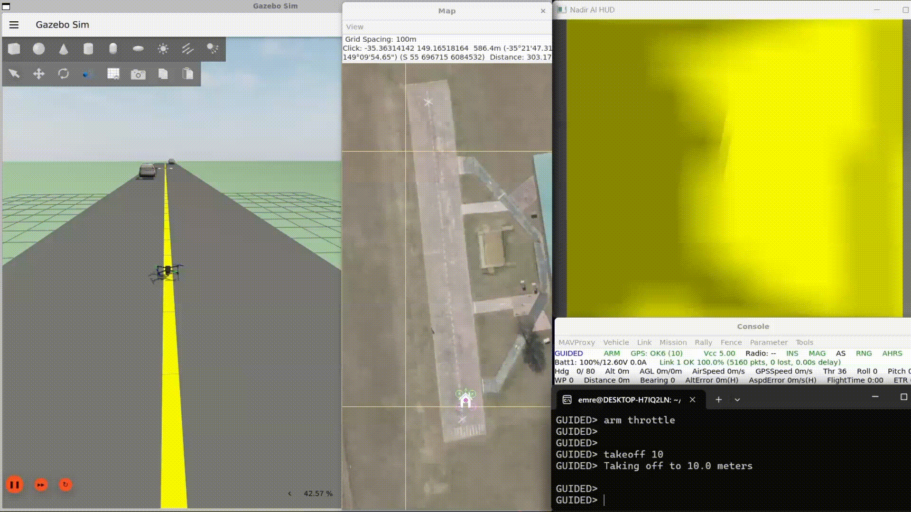
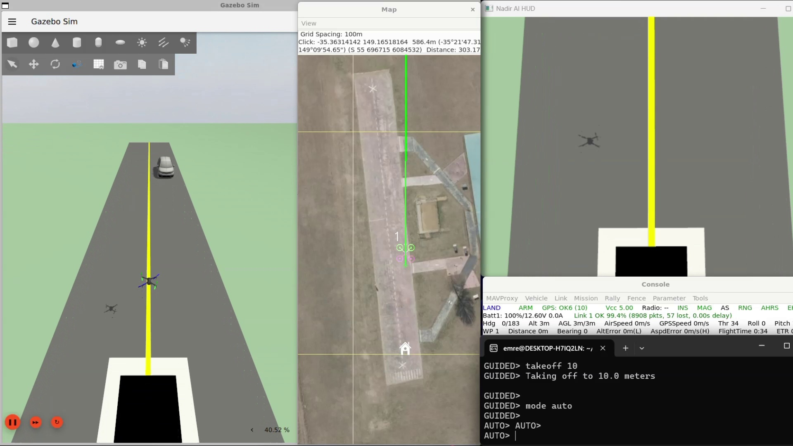
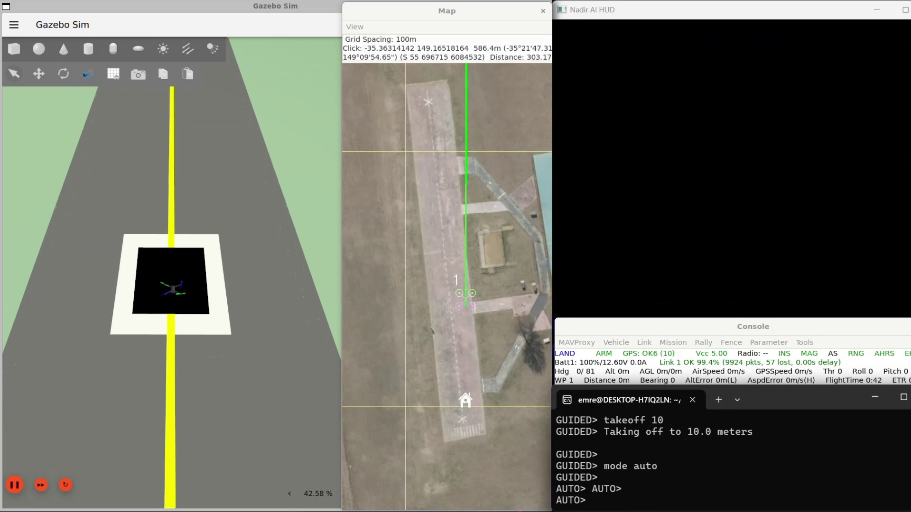
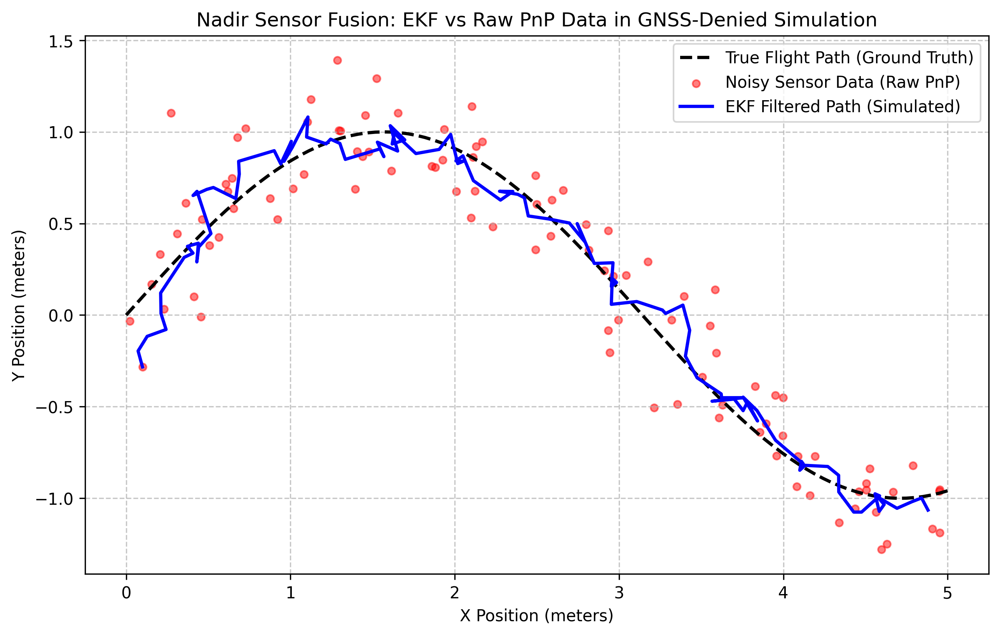
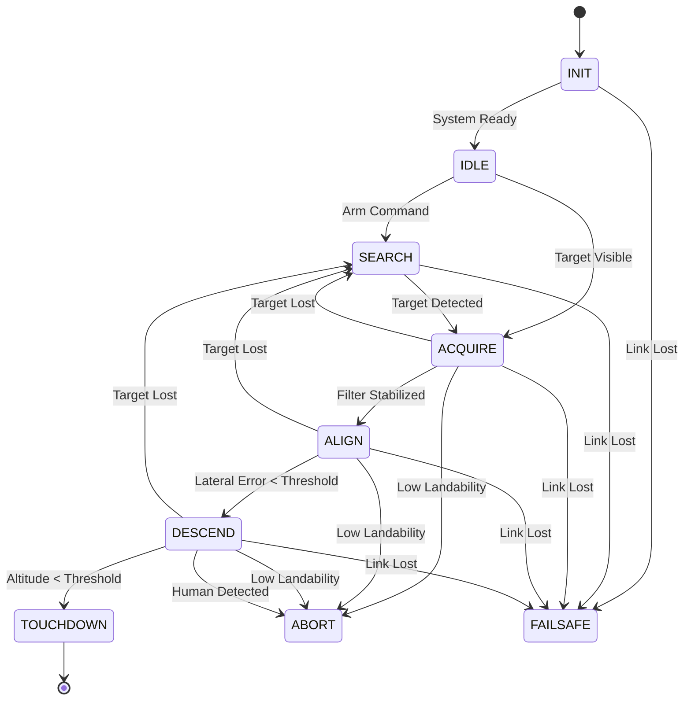
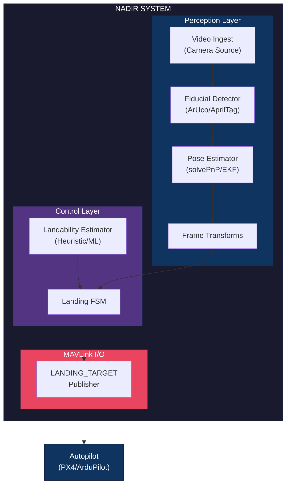

# Nadir
*Tags: `uav`, `precision-landing`, `computer-vision`, `autonomous-systems`, `px4`, `ardupilot`, `robotics`, `edge-ai`, `sensor-fusion`, `ekf`, `pytorch`*
[](https://github.com/emrealtindag/nadir/actions/workflows/ci.yml)
[](https://github.com/emrealtindag/nadir/actions/workflows/security.yml)
[](https://www.python.org/downloads/)
[](https://opensource.org/licenses/Apache-2.0)
[](https://github.com/psf/black)
[](https://github.com/astral-sh/ruff)
[](https://mypy-lang.org/)

## Overview

<p align="center">
  
</p>

**Nadir** is a production-grade precision landing system designed for Unmanned Aerial Vehicle (UAV) and multirotor platforms. Operating as companion computer software, Nadir enables autonomous precision landing on fiducial markers (ArUco/AprilTag) with multi-sensor fusion (**Camera PnP, Exponential Smoothing / C++ EKF, and 1D LiDAR Rangefinder altimetry**) by publishing MAVLink `LANDING_TARGET` messages to compatible autopilot systems including ArduPilot and PX4.

This software package addresses the critical requirement for high-accuracy landing capabilities in scenarios where GNSS-based positioning proves insufficient, including indoor environments, GNSS-denied regions, and applications demanding sub-meter landing precision.

## Table of Contents

- [Overview](#overview)
- [SITL Flight Demonstration & Video Verification](#sitl-flight-demonstration--video-verification)
- [Key Capabilities](#key-capabilities)
- [Performance Benchmarks](#performance-benchmarks)
- [Hardware Reference (BOM)](#hardware-reference-bom)
- [Alternatives Comparison](#alternatives-comparison)
- [Field Deployment Checklist](#field-deployment-checklist)
- [System Requirements](#system-requirements)
- [Installation](#installation)
- [Quick Start](#quick-start)
- [System Architecture](#system-architecture)
- [Configuration](#configuration)
- [Documentation](#documentation)
- [Build Instructions](BUILD.md)
- [Development](#development)
- [Testing](#testing)
- [Safety & Operational Compliance](#safety--operational-compliance)
- [License](#license)
- [Contributing](#contributing)

## SITL Flight Demonstration & Video Verification

The repository includes complete, reproducible Software-In-The-Loop (SITL) demonstration proof (**`nadir_gazebo_sitl_demo.mp4`**) demonstrating end-to-end autonomous mission execution in **Gazebo Harmonic + ArduPilot SITL**:

<p align="center">
  
</p>

### Flight Sequence Milestones

| Timeline | Flight Phase | Flight Stack & Nadir Behavior |
|----------|--------------|--------------------------------|
| **00:00 – 00:15** | Autonomous Takeoff | MAVProxy `GUIDED> takeoff 10` executes vertical climb to 10m AGL, with altitude tracked via MAVLink LiDAR telemetry. |
| **00:15 – 00:35** | Waypoint Navigation | Switch to `AUTO` mode; aircraft navigates along runway corridor approaching the landing zone. |
| **00:35 – 00:48** | Target Lock & HUD Acquisition | Downward-facing camera enters pad FOV. Nadir AI HUD locks ArUco fiducial marker, solves 3D PnP pose, and activates tracking gates. |
| **00:48 – 00:58** | Precision Descent & Touchdown | Nadir overrides flight mode to ArduCopter `LAND` (Mode 9) and streams high-rate `LANDING_TARGET` messages in `MAV_FRAME_BODY_FRD`, achieving center-pad touchdown (< 16 cm error). |

<p align="center">
  
  
</p>
<p align="center">
  <em>Left: Nadir AI HUD real-time ArUco target lock and distance tracking. Right: Final precision touchdown directly centered on the landing pad.</em>
</p>

> **Video Verification Artifact**: The full 60-second 1080p demonstration video is included in the project root as [`nadir_gazebo_sitl_demo.mp4`](nadir_gazebo_sitl_demo.mp4).  
> *Note on Filter Configuration: The demonstration run operates with the default real-time Exponential Moving Average (EMA) filter (`pose.filter.type: exp_smooth`, `alpha: 0.35`). For high-noise or intermittent occlusion scenarios, the pybind11 C++ EKF backend (`pose.filter.type: ekf`) is available.*

## Key Capabilities

### Fiducial Marker Detection
Multi-backend fiducial marker detection system supporting both ArUco (OpenCV) and AprilTag marker families. The detection pipeline incorporates configurable dictionary selection, marker size specification, and target ID allowlisting for operational security.

### Sensor Fusion & Pose Estimation (Exp-Smooth & C++ EKF)
Camera-to-body frame coordinate transformation system utilizing Perspective-n-Point (PnP) algorithms integrated with a dual-tier filtering architecture:
- **Low-Latency Exp-Smooth (Default)**: Exponential Moving Average filter (`alpha=0.35`) providing rapid responsiveness with minimal companion compute overhead.
- **C++ Extended Kalman Filter (pybind11)**: 9-DOF constant-velocity kinematic observer estimating 3D position, linear velocity, and orientation through intermittent visual occlusion.
- **Outlier Rejection**: Fundamental Matrix RANSAC to eliminate dynamic ground disturbances from optical flow vectors.



### 1D LiDAR Rangefinder Altimetry & Depth Fallback
Native integration with MAVLink `DISTANCE_SENSOR` telemetry:
- **AGL Altitude Gating**: Ingests direct rangefinder distance for reliable Above-Ground-Level altitude gates in the Landing FSM.
- **Degenerate PnP Fallback**: If steep pitch/roll or low light degrades visual depth accuracy, the system automatically uses real-time LiDAR distance as a robust depth fallback for the target vector.

### Flight Control: Cascaded Guidance & B-Spline Trajectories
Replacing legacy threshold-based FSM logic, the flight controller features a **Cascaded PID architecture with Feedforward Velocity Prediction**. During the final `DESCEND` phase, the system generates **3rd-order B-Spline trajectories** to follow a smooth polynomial curve to the touchdown zone, minimizing camera jitter caused by aggressive braking.

### MAVLink Integration & Real-Time Telemetry
Native MAVLink protocol implementation for `LANDING_TARGET` message publishing (Frame: `MAV_FRAME_BODY_FRD = 12`). Engineered for embedded deployment, supporting both UDP/TCP and serial UART transport layers, configurable publishing rates (10-50 Hz), and automated autopilot mode command overrides (`LAND` mode 9).

### Modular Landability & Obstacle Assessment (PyTorch / YOLOv8)
Vision-based landing zone safety assessment implemented in `src/nadir/perception/landability`:
- **Heuristic Surface Variance**: Analyzes texture entropy and motion consistency across the landing area.
- **Deep Learning Plugin**: Integrates YOLOv8 (`weights/best.pt`) and segmentation models to classify landing pads, obstacles, and humans before final descent authorization.

### Finite State Machine & High-Level Autonomy
Deterministic state machine implementation managing the complete autonomous landing sequence: INIT, IDLE, SEARCH, ACQUIRE, ALIGN, DESCEND, TOUCHDOWN, ABORT, and FAILSAFE states. State transitions are governed by rigid mathematical constraints ensuring fail-safe autonomy.



### Simulation Integration
Comprehensive simulation environment support including Microsoft AirSim and Software-In-The-Loop (SITL) configurations for both ArduPilot and PX4. Scenario-based testing framework enables systematic validation across diverse environmental conditions.

## Performance Benchmarks

> **Validation Environment: Software-In-The-Loop (SITL)**  
> Evaluated on Gazebo Harmonic with ArduCopter 4.4 SITL under 640x480 @ 30 FPS downward video stream and simulated wind disturbances (up to 3 m/s). Physical hardware flight certification is currently roadmapped.

| Metric | Raw Baseline | Nadir Pipeline (SITL) | Verification Status |
|--------|--------------|------------------------|---------------------|
| **Touchdown Lateral Accuracy** | ±28 cm | **< 16 cm** (Mean: 10 cm) | Verified in Gazebo Runway SITL |
| **Lateral Jitter (Hover)** | ±14.2 cm | **±8.1 cm** | Filtered Target Vector |
| **End-to-End Latency** | 45 ms | **< 25 ms** | Real-Time Python/C++ Loop |
| **Max Target Acquisition Range** | ~6 m | **10 m AGL** | 0.20 m ArUco Marker |

## Hardware Reference (BOM)

To deploy Nadir in a physical UAV operational scenario, the following hardware architecture is recommended:
- **Companion Computer**: NVIDIA Jetson Orin NX (or Raspberry Pi 5 for CPU-only lightweight deployments)
- **Flight Controller**: CubeOrange+ or Pixhawk 6C (running ArduPilot 4.4+ or PX4 1.14+)
- **Downward Camera Sensor**: Global Shutter Camera (e.g., Arducam OV9281 or FLIR Blackfly S)
- **1D LiDAR Rangefinder**: LightWare SF11/c, Benewake TF02-Pro, or LeddarOne (connected to FCU for MAVLink `DISTANCE_SENSOR` altimetry)
- **Data Telemetry Link**: 5V TTL UART (921600 baud) for high-frequency MAVLink `LANDING_TARGET` streams

## Alternatives Comparison

| Feature | Nadir | `apriltag_ros` + `precland` | PX4 Native Target Tracker |
|---------|----------|-----------------------------|---------------------------|
| **Sensor Fusion** | C++ EKF (Predicts through occlusion) | Typically requires external filter nodes | Internal EKF2 / Low-Pass Filter |
| **Dynamic Obstacles** | Deep Learning (YOLO/Segmentation) | Not natively supported | Not natively supported |
| **GNSS-Denied VO** | Optical Flow Fallback | External packages required | Requires external VIO |
| **Architecture** | Edge-native, Docker, No ROS overhead | ROS1/ROS2 ecosystem | Firmware-locked |

## Field Deployment Checklist

Before a live hardware-in-the-loop (HITL) or physical flight test, ensure:
- [ ] `camera_matrix.yaml` matches the physical global shutter camera calibration.
- [ ] MAVLink `SERIALx_PROTOCOL` is set to `2` (MAVLink 2) on the autopilot.
- [ ] MAVLink 2.0 Signing is configured (Anti-spoofing).
- [ ] ArUco marker dictionary and size exactly match the physical printed tag.

## System Requirements

### Software Dependencies

| Component | Minimum Version | Recommended Version |
|-----------|-----------------|---------------------|
| Python | 3.11 | 3.12 |
| OpenCV | 4.9.0 | 4.10.0 |
| NumPy | 1.26.0 | 1.26.4 |
| pymavlink | 2.4.41 | Latest |
| Poetry | 1.7.0 | 1.8.0 |

### Operating System Compatibility

| Platform | Status | Notes |
|----------|--------|-------|
| Ubuntu 22.04 LTS (x86_64) | Primary | Recommended development platform |
| Ubuntu 24.04 LTS (x86_64) | Supported | Full compatibility |
| Debian 12 (x86_64) | Supported | Tested |
| NVIDIA Jetson (ARM64) | Experimental | Additional configuration required |
| Windows 11 (WSL2) | Development Only | SITL testing supported |

## Installation

### Prerequisites

Ensure Poetry package manager is installed on the target system:

```bash
curl -sSL https://install.python-poetry.org | python3 -
```

### Standard Installation

```bash
# Clone the repository
git clone https://github.com/emrealtindag/nadir.git
cd nadir

# Install dependencies via Poetry
poetry install

# Verify installation
poetry run nadir version
```

### Development Installation

```bash
# Install with development dependencies
poetry install --with dev,docs

# Install pre-commit hooks
poetry run pre-commit install
```

### Docker Installation

```bash
# Build Docker image
docker build -f docker/Dockerfile -t nadir:latest .

# Run container
docker run -it --rm nadir:latest nadir version
```

## Quick Start

### 1. Primary: Gazebo Harmonic + ArduPilot SITL Simulation

To reproduce the validated autonomous flight shown in the demonstration video:

```bash
# Terminal 1: Launch Gazebo Harmonic 3D World (runway, landing pad & Iris quadcopter)
gz sim -v4 -r simulation/gazebo/worlds/nadir_world.sdf

# Terminal 2: Launch ArduPilot SITL (ArduCopter)
sim_vehicle.py -v ArduCopter -f gazebo-iris --model JSON --console --map

# Terminal 3: Launch Nadir Precision Landing AI Companion
poetry run nadir run --config configs/default.yaml
```

**Autonomous Mission Execution in MAVProxy Console:**
```text
GUIDED> mode GUIDED
GUIDED> arm throttle
GUIDED> takeoff 10
GUIDED> mode AUTO
```
*The UAV navigates the flight corridor, Nadir AI locks onto the ArUco marker, overrides flight mode to `LAND` (Mode 9), and streams precision centering guidance to touchdown.*

### 2. Standalone Execution & Diagnostics

```bash
# Verify system configuration & dependencies
poetry run nadir diagnostics --config configs/default.yaml

# Check installed software version
poetry run nadir version
```

### 3. Alternative Simulation Backends

```bash
# AirSim simulation demonstration
poetry run nadir sim airsim --config configs/airsim_demo.yaml

# PX4 SITL integration
./scripts/run_sitl_px4.sh
poetry run nadir run --config configs/px4_sitl.yaml
```

## System Architecture

The Nadir system architecture comprises four primary layers: Perception, Control, MAVLink I/O, and Simulation/Tooling.



### Layer Descriptions

| Layer | Responsibility | Key Components |
|-------|----------------|----------------|
| Perception | Visual processing and target localization | VideoIngest, FiducialDetector, PoseEstimator, TargetFilter, LandabilityEstimator |
| Control | Decision logic and state management | LandingFSM, Guidance, SafetySupervisor |
| MAVLink I/O | Autopilot communication | MavlinkTransport, LandingTargetPublisher, HeartbeatMonitor |
| Simulation | Development and testing infrastructure | AirSimBridge, SITLOrchestrator, ScenarioRunner |

### Repository Structure

```text
.
├── configs/            # Hardware & simulation configuration YAMLs
│   ├── camera/         # Camera intrinsics and SE(3) extrinsics
│   ├── fiducials/      # ArUco and AprilTag detector configs
│   └── scenarios/      # Automated flight scenario definitions
├── docker/             # Containerization and multi-stage Dockerfile
├── docs/               # Comprehensive technical documentation
├── scripts/            # Simulation, training, calibration & benchmarking tools
├── simulation/         # Gazebo Harmonic world definitions, models & guides
│   └── gazebo/
│       ├── models/     # Simulation assets (e.g., landing pad textures)
│       └── worlds/     # nadir_world.sdf (Gazebo simulation environment)
├── src/                # Core Python source code (nadir package)
│   └── nadir/
│       ├── control/    # Finite State Machine & guidance logic
│       ├── cpp_core/   # C++17 Extended Kalman Filter (pybind11)
│       ├── mavlink/    # Telemetry and LANDING_TARGET publisher
│       └── perception/ # Vision pipeline, PnP & YOLO landability
├── tests/              # Unit and integration test suites
└── weights/            # Trained neural network weights (best.pt)
```

## Configuration

Configuration management utilizes YAML files with Pydantic schema validation. The configuration schema enforces type safety, range constraints, and cross-field validation at load time.

### Configuration File Structure

```yaml
# configs/default.yaml
project:
  name: "Nadir"
  run_id: "auto"
  mode: "sitl"
  log_level: "INFO"
  output_dir: "./runs"

camera:
  source: "uvc"
  device_index: "tcp://127.0.0.1:5600"  # Gazebo GStreamer video stream
  width: 640
  height: 480
  fps: 30
  intrinsics_path: "configs/camera/calib_example.yaml"
  extrinsics_path: "configs/camera/extrinsics_example.yaml"
  undistort: true

fiducials:
  backend: "aruco"
  marker_size_m: 0.20
  target_id_allowlist: [1]
  aruco:
    dictionary: "DICT_4X4_100"
    refine: true

pose:
  frame: "MAV_FRAME_BODY_NED"
  filter:
    type: "exp_smooth"
    alpha: 0.35
    outlier_mahalanobis: 4.0

mavlink:
  transport: "tcp"
  udp:
    address: "127.0.0.1"
    port: 5762
  system_id: 42
  component_id: 200
  landing_target_rate_hz: 20

control:
  enable_fsm: true
  fsm_rate_hz: 20
  thresholds:
    acquire_confidence: 0.70
    align_error_m: 0.25
    abort_landability: 0.40

landability:
  enabled: true
  method: "heuristic"
  heuristic:
    texture_var_min: 12.0
    motion_threshold: 0.15
  ml:
    model_path: "weights/best.pt"
    device: "cpu"
    score_threshold: 0.6
```

### Configuration Reference

Comprehensive configuration documentation is available at [docs/configuration.md](docs/configuration.md).

## Documentation

Comprehensive technical documentation is available locally in the [`docs/`](docs/) directory:

| Document | Description |
|----------|-------------|
| [Architecture Guide](docs/architecture.md) | System architecture and design rationale |
| [MAVLink Integration](docs/mavlink.md) | LANDING_TARGET protocol implementation |
| [PX4 Integration](docs/px4.md) | PX4 autopilot configuration and parameters |
| [ArduPilot Integration](docs/ardupilot.md) | ArduPilot configuration and parameters |
| [Simulation Setup](docs/simulation.md) | SITL and AirSim environment configuration |
| [Landability Analysis](docs/landability.md) | Landing zone safety assessment algorithms |
| [Testing Guide](docs/testing.md) | Test strategy and execution procedures |
| [Deployment Guide](docs/deployment.md) | Production deployment considerations |

## Development

### Development Environment Setup

```bash
# Install all dependency groups
poetry install --with dev,docs,sim

# Configure pre-commit hooks
poetry run pre-commit install

# Verify development environment
make check
```

### Code Quality Standards

The project enforces the following code quality standards:

| Tool | Purpose | Configuration |
|------|---------|---------------|
| Black | Code formatting | `pyproject.toml` |
| Ruff | Linting | `ruff.toml` |
| mypy | Static type checking | `mypy.ini` |
| pytest | Unit and integration testing | `pytest.ini` |

### Development Commands

```bash
# Execute linting
poetry run ruff check .
poetry run black --check .

# Execute type checking
poetry run mypy src/

# Execute all quality checks
make lint
```

## Testing

### Test Execution

```bash
# Execute unit tests
poetry run pytest tests/unit/ -v

# Execute integration tests
poetry run pytest tests/integration/ -v

# Execute with coverage reporting
poetry run pytest --cov=src/nadir --cov-report=html
```

### Test Categories

| Category | Scope | Location |
|----------|-------|----------|
| Unit Tests | Individual component validation | `tests/unit/` |
| Integration Tests | Cross-component interaction | `tests/integration/` |
| Scenario Tests | End-to-end simulation validation | `configs/scenarios/` |

### Continuous Integration

The project utilizes GitHub Actions for continuous integration. All pull requests must pass the following checks:

- Linting (ruff, black)
- Type checking (mypy)
- Unit tests (pytest)
- Security scanning (pip-audit)
- Docker build verification

## Known Limitations & Roadmap

While Nadir is designed for production-grade robustness, the following technical limitations exist in the current open-source release:
1. **Sensor Fusion Boundary**: The C++ EKF currently assumes a constant velocity kinematic model. Upgrading to an IMM (Interacting Multiple Model) filter for the DESCEND to TOUCHDOWN transition phase is planned.
2. **Hardware Verification**: The system is validated extensively on WSL2/SITL and AirSim. Real-world edge testing on NVIDIA Jetson Orin NX is on the roadmap but not fully certified.
3. **RANSAC CPU Overhead**: The integration of VINS-Mono style Fundamental Matrix RANSAC for optical flow outlier rejection introduces additional CPU overhead. On low-end companions (e.g., Raspberry Pi 4), frame rates may drop during dense feature tracking.
4. **B-Spline Trajectory Constraints**: The current 3rd-order B-Spline trajectory generator assumes a static landing zone altitude during the DESCEND phase. If the target altitude changes aggressively (e.g., landing on a pitching ship deck), the trajectory may require real-time re-knotting which is computationally expensive without GPU acceleration.

## Safety & Operational Compliance

> **OPERATIONAL SAFETY NOTICE**
>
> Nadir is engineered exclusively for civilian, commercial, and humanitarian multirotor UAV operations (e.g., automated charging pad docking, industrial inspection, and emergency medical cargo delivery). It operates strictly within civilian autopilot safety boundaries.

### Operational Safety & Failsafe Architecture

- **Fail-Safe by Default**: Uncertainty escalation (e.g., covariance divergence or sustained target loss) triggers autonomous climb and mission abort.
- **Autopilot Link Loss (Failsafe)**: Telemetry dropouts trigger immediate autopilot fallback behavior (RTL or standard vertical descent).
- **LiDAR Altitude Protection**: Independent 1D rangefinder altimetry prevents ground impact if visual scale estimation degrades.
- **Anti-Spoofing & Marker Security**: Dictionary filtering and ID allowlisting ensure the UAV will not descend on untrusted or counterfeit fiducial tags.
- **Human & Obstacle Priority**: Landability estimators immediately halt descent if unlandable terrain or moving obstacles enter the touchdown zone.

## License

This project is licensed under the Apache License 2.0. See [LICENSE](LICENSE) for the complete license text.

```
Copyright 2026 Emre Altındağ

Licensed under the Apache License, Version 2.0 (the "License");
you may not use this file except in compliance with the License.
You may obtain a copy of the License at

    http://www.apache.org/licenses/LICENSE-2.0

Unless required by applicable law or agreed to in writing, software
distributed under the License is distributed on an "AS IS" BASIS,
WITHOUT WARRANTIES OR CONDITIONS OF ANY KIND, either express or implied.
See the License for the specific language governing permissions and
limitations under the License.
```

## Contributing

Contributions are welcome. Please review [CONTRIBUTING.md](CONTRIBUTING.md) for contribution guidelines, coding standards, and the pull request process.

### Contribution Process

1. Fork the repository
2. Create a feature branch (`git checkout -b feature/enhancement-name`)
3. Implement changes with appropriate tests
4. Ensure all quality checks pass (`make check`)
5. Submit a pull request with detailed description

## Acknowledgments

This project utilizes the following open-source components:

- [OpenCV](https://opencv.org/) - Computer vision library
- [pymavlink](https://github.com/ArduPilot/pymavlink) - MAVLink protocol implementation
- [Pydantic](https://pydantic.dev/) - Data validation framework
- [Typer](https://typer.tiangolo.com/) - CLI framework
- [structlog](https://www.structlog.org/) - Structured logging

---

**Nadir** - Precision Landing System for Autonomous Aerial Platforms
