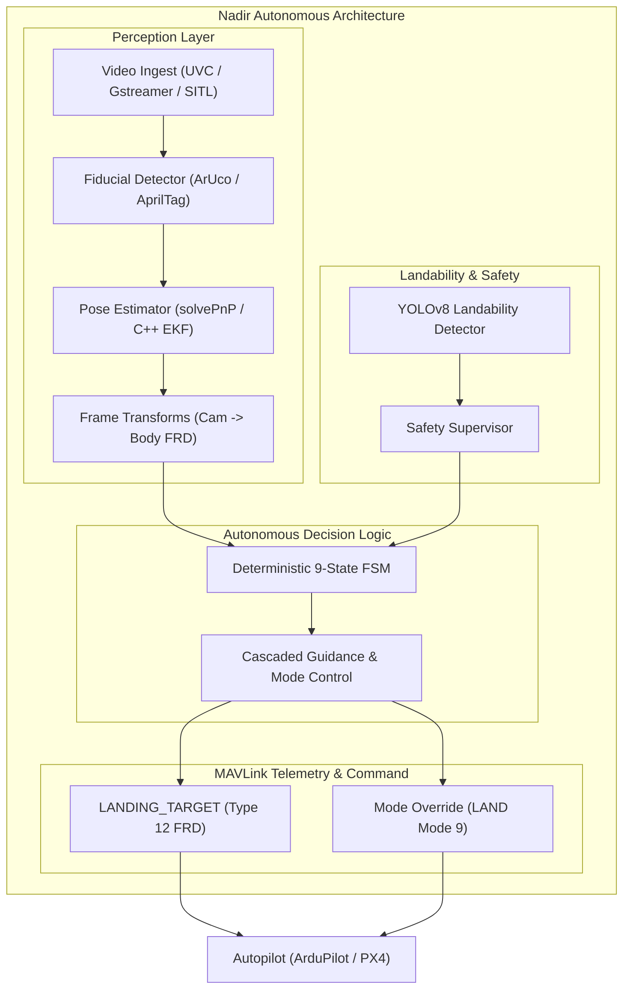

# System Architecture

The Nadir precision landing system is structured into four modular, decoupled layers:

---

## 1. Perception Layer
- **Video Ingest**: Supports Linux V4L2/UVC devices, video files for playback debugging, and TCP/UDP network video streams (such as Gazebo Harmonic GStreamer video feeds on `tcp://127.0.0.1:5600`).
- **Fiducial Detection**: Built-in support for OpenCV ArUco (`cv2.aruco`) and AprilTag (`tag36h11`). Provides sub-pixel refinement and ID allowlisting.
- **Pose Estimation**: Perspective-n-Point (`solvePnP`) coupled with camera intrinsic calibration matrices and distortion coefficients.
- **Coordinate Transforms**: Translates 3D coordinates from the camera optical frame ($+Z$ forward, $+X$ right, $+Y$ down) to the aircraft body frame (Forward-Right-Down / North-East-Down).

---

## 2. Landability & Safety Layer
- Assesses environmental safety in the touchdown zone.
- Utilizes YOLOv8 (`weights/best.pt`) to detect humans, vehicles, or physical obstacles.
- If an unlandable condition or human presence is detected, the safety supervisor immediately commands an autonomous `ABORT` or `GO_AROUND`.

---

## 3. Finite State Machine (Control Layer)
Governed by a deterministic 9-state machine:
1. `INIT`: Hardware and communication link verification.
2. `IDLE`: Armed standby awaiting target search command.
3. `SEARCH`: Active pattern scan for fiducial markers.
4. `ACQUIRE`: Target acquired; confidence filtering and verification.
5. `ALIGN`: Centering UAV laterally over landing pad.
6. `DESCEND`: Vertical descent with continuous target tracking.
7. `TOUCHDOWN`: Final contact and motor disarm notification.
8. `ABORT`: Controlled pull-up upon obstacle detection.
9. `FAILSAFE`: Telemetry or camera disconnect contingency.

---

## 4. MAVLink Layer
- Publishes high-frequency `LANDING_TARGET` messages (MAVLink frame `MAV_FRAME_BODY_FRD = 12`).
- Sends mode override commands (`MAV_CMD_DO_SET_MODE` to `LAND` mode 9 in ArduCopter) once target acquisition is locked to ensure smooth vertical descent.
